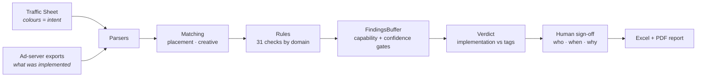

# QA2 — automated second-pass QA for digital ad campaigns

> From **≈5 minutes per decision set** checked by hand to **55 seconds for a full request of 156 placements**.

<p align="center">
  
  <br>
  <sub>Simulated demo with fictional data · full video: <a href="media/qa2_demo.mp4">media/qa2_demo.mp4</a></sub>
</p>

QA2 is a tool I designed and built in my Ad Operations role. It does the
mandatory **second QA** of every campaign request: it reads the Traffic
Sheet, compares it against what was actually implemented in the ad
server, and delivers a signed report with the evidence.

This repository is a **portfolio showcase**. The production version runs
internally; what is here is the backbone of its engine, a runnable demo
on synthetic data, and the story behind it. See
[What is in this repository](#what-is-in-this-repository).

---

## The problem

Every request needs a second QA, and until now it was done by eye:

1. Open the Traffic Sheet and work out, **from the cell colours**, what was requested.
2. Find the placement in the ad server.
3. Open its decision set.
4. Compare creatives, flight dates, rotation and verification partner, one by one.

Repeated dozens of times per request. Slow, and the 140th placement
never gets the same attention as the first.

## The result

| | Time | Scope |
|---|---|---|
| By hand | **≈ 5 min** | one decision set |
| With QA2 | **55 s** | the whole request — 156 placements |

Both numbers are measured: the manual one with a stopwatch, the QA2 one
from the app's own timestamped run log.

It is not only faster. On its first run over a real request, QA2 caught
**two rotations crossed between sizes** (a 300x250 creative on a 300x600
placement and vice versa) that had passed two manual reviews.

## How it works



* **Colours are data.** Green means *new*, red means *remove*, yellow is
  *on hold* and grey is *not worked* — the last two are out of scope and
  produce zero findings.
* **Every check emits a finding** with a status (`PASS`, `FAIL`,
  `REVIEW`, `NOT_VERIFIED`), expected vs actual, and a recommended action.
* **Two verdicts, not one.** What Ad Ops trafficked (placements,
  creatives, dates, rotation) is judged apart from tags and pixels that
  third parties deliver later — so the report says *which* side needs work.

More detail in [docs/ARCHITECTURE.md](docs/ARCHITECTURE.md).

## Design principles

1. **What could not be checked never passes green.** If an input is
   missing, the finding becomes `NOT_VERIFIED`, never a silent pass.
   A green report means the comparison actually happened.
2. **Low confidence goes to a human.** A `FAIL` from a fuzzy match is
   degraded to `REVIEW` instead of being asserted.
3. **The decision stays human.** Differences that need judgement are
   signed by a person, and the report records who, when and why.
   Identical findings can be signed as a group: 100 of the same is one
   decision, not one hundred.
4. **Every real bug becomes a test.** Each fix in production started
   from a real request and ended in an automated test, so it cannot
   come back.
5. **Explain, don't just judge.** Every finding says what was compared,
   what was expected and what was found.

## What is in this repository

| Included | Not included |
|---|---|
| The real engine core: `findings` (the buffer and its gates), `verdict` (two-scope verdict), `colors` (fill → intent), `normalize` (weights, dimensions), `dates`, `review` (grouped sign-off), `report_name` | Production parsers for real Traffic Sheet layouts |
| A runnable demo pipeline with six rules over synthetic data | The ad-server connector |
| 56 tests (47 from production + 9 for the demo) | Account-specific rules and configuration |
| Demo video and LinkedIn carousel | Any client, campaign or colleague data |

All data in this repository is fictional: *Northwind Coffee* is not a
real campaign and the placement IDs are invented.

**Production in numbers:** Python 3.11 · Streamlit · pandas · openpyxl ·
Playwright · ReportLab · 31 validation rules · 660+ automated tests ·
ships as a portable `.zip` with its own Python, so nothing needs to be
installed · runs locally, and client files never leave the user's machine.

## Run the demo

```bash
python -m venv .venv
source .venv/bin/activate        # Windows: .venv\Scripts\activate
pip install -r requirements.txt

python -m qa2.demo               # writes sample_data/ and out/<date>_QA_Report_<campaign>.xlsx
python -m pytest                 # 56 tests
```

Expected output (abridged):

```
QA2 demo · Northwind Coffee Holiday 2026
6 placements in scope, 2 rows out of scope (hold / not worked)

  FAIL          DIM-001  40021877  A 300x250 creative is serving on a 300x600 placement.
  FAIL          DIM-001  40021903  A 300x600 creative is serving on a 300x250 placement.
  FAIL          CRE-002  40021960  Creative marked for removal is still assigned.
  REVIEW        DAT-001  40021955  Holiday_Spot_15s has no end date in the ad server, ...
  NOT_VERIFIED  ROT-001  40021836  Requested rotation weights were not compared.
  ...
Overall: REQUIRES CORRECTION
  Implementation  REQUIRES CORRECTION
  Tags & pixels   PASSED
```

## Project layout

```
qa2/
  findings.py      Finding, FindingsBuffer (capability + confidence gates), Scorecard
  verdict.py       verdict ladder, implementation vs tags & pixels, headline
  colors.py        fill colour -> intent (GREEN / RED / YELLOW / GREY / WHITE)
  normalize.py     rotation weights, dimensions, ids
  dates.py         date columns in mixed formats
  review.py        grouping findings for one-click sign-off
  report_name.py   <date>_QA_Report_<campaign>.xlsx
  demo/            synthetic data, demo pipeline, CLI
tests/
docs/ARCHITECTURE.md
media/             demo video, preview GIF, carousel
```

## Resumen en español

QA2 es una herramienta que diseñé y construí en mi rol de Ad Operations.
Hace el **segundo QA** obligatorio de cada solicitud de campaña: lee la
Traffic Sheet (incluidos los colores que marcan qué se pidió), la compara
contra lo implementado en el ad server y entrega un reporte firmado con
la evidencia. Pasó de **≈5 minutos por decision set** a mano a **55
segundos para una solicitud completa de 156 placements**, y en su
primera corrida encontró dos rotaciones cruzadas que habían pasado dos
revisiones manuales.

Este repositorio es una vitrina: el núcleo real del motor, una demo
ejecutable con datos ficticios y sus pruebas. No contiene datos de
clientes, credenciales ni conectores internos.

## About

**Camilo Mantilla** — Ad Operations. I build tools that take the
repetitive part out of campaign operations so the team's judgement goes
where it matters.

QA2 was built AI-assisted: I designed the rules, the workflow and the
checks from real requests, and worked with an AI coding assistant to
write and test the code. It is how I learned to build software, and
I'm still learning.

*Shared for portfolio purposes. All rights reserved.*
