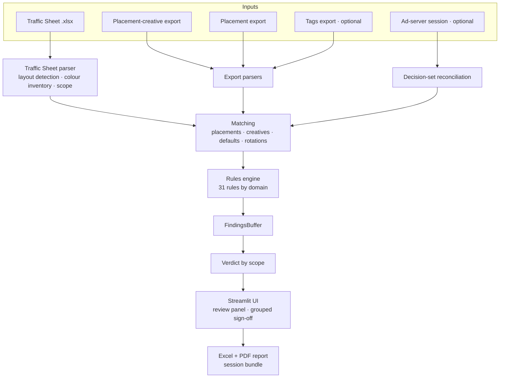

# Architecture

How the production version of QA2 is put together, at the level of
detail that does not depend on any account or internal system.

## Pipeline

## The pieces

**Traffic Sheet parser.** Traffic Sheets are human documents: merged
cells, legends, hidden sheets, several layouts. The parser finds the
data region first and only then reads colours, so a green legend or a
coloured header never counts as a request. Colours are resolved from
theme + tint, not just RGB, and classified by hue family
(`qa2/colors.py`). A colour that cannot be classified is never guessed:
it becomes `REVIEW`.

**Matching.** Rows are matched to the exports by placement ID, then by
creative ID, then by name — each step recorded in the finding's
evidence, so a reviewer can see *how* two things were paired. Matches
below high confidence cannot produce a hard `FAIL`.

**Rules.** Small functions grouped by domain (identity, scope, dates,
dimensions, creative, rotation, URL, attribution, pixel, tag, taxonomy).
Each rule declares the inputs it needs; it does not decide what happens
when they are missing — the buffer does.

**FindingsBuffer** (`qa2/findings.py`) is the single point of emission
and applies, in order:

1. **Capability gate** — if a required input is missing, the finding
   becomes `NOT_VERIFIED` with the reason. Never `FAIL`, never silence.
2. **Confidence gate** — a `FAIL` below high confidence becomes `REVIEW`.
3. **Status/severity coherence.**
4. **Deterministic IDs and dedup** — the same finding gets the same ID
   across runs, so a signature stays attached to the same finding when the QA is run again.

**Verdict** (`qa2/verdict.py`). Findings are split into two scopes:
*implementation* (what Ad Ops trafficked) and *tags & pixels* (what is
delivered to or by third parties). Each gets its own verdict on the
ladder `BLOCKED > FAILED > NEEDS_REVIEW > PASSED`; the request's verdict
is the worse of the two, and a one-line headline says which side needs
work.

**Review and sign-off** (`qa2/review.py`). `REVIEW` findings are grouped
by rule and reason with the variable names stripped, so a hundred
identical differences are one decision. Every signature records who,
when and why, and the report keeps signed items as callouts rather than
failures.

**Reports.** Excel and PDF with the verdicts, every finding with
expected vs actual, and the signatures. The file name starts with an ISO
date so a shared folder sorts itself (`qa2/report_name.py`). A session
bundle lets a second person reload the exact inputs and sign.

## Delivery

* Runs locally through Streamlit, bound to `localhost` only, with usage
  statistics off. Client files are read on the user's machine and never
  sent anywhere.
* Ships as a portable `.zip` that carries its own Python runtime and
  browser, so it needs no installation or admin rights. Uninstalling is
  deleting the folder.
* The launcher writes a startup log before anything else, so a machine
  where "nothing opens" still leaves a trace to diagnose.
* Each release runs the full test suite (660+ tests) before it is
  packaged.
